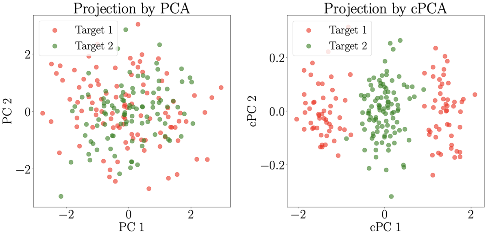
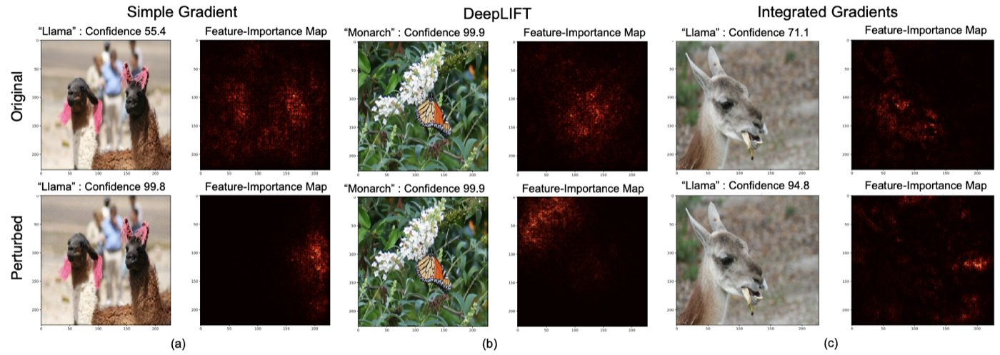

Here are some papers that I have written, from my PhD work on machine learning for biology and medicine to more recent work on language models and tools for sharing machine learning models. An asterisk (\*) means equal contribution.

Featured papers:
----
* **Exploring Patterns Enriched in a Dataset with Contrastive Principal Component Analysis [[PDF](https://www.nature.com/articles/s41467-018-04608-8.pdf), [Code](https://github.com/abidlabs/contrastive)]**  
Abubakar Abid\*, Martin Zhang\*, Vivek Bagaria, James Zou.  
_Nature Communications, 2018_   

* **Model-Based Estimation of Respiratory Parameters from Capnography, with Application to Diagnosing Obstructive Lung Disease [[Paper](https://doi.org/10.1109/TBME.2017.2699972)]**   
  Abubakar Abid<b>,</b> Rebecca Mieloszyk, George Verghese, Baruch Krauss, Thomas Heldt.  
  _IEEE Transactions on Biomedical Engineering, 2017_  

 * **Interpretation of Neural Networks is Fragile [[PDF](https://arxiv.org/pdf/1710.10547), [Code](https://github.com/amiratag/InterpretationFragility)]**  
  Abubakar Abid\*, Amirata Ghorbani\*, James Zou.   
  _AAAI 2019_  

Other papers and presentations (33):
----
_Tools for Building and Sharing ML Models_
  * **MolDesigner: Interactive Design of Efficacious Drugs with Deep Learning [[PDF](https://arxiv.org/pdf/2010.03951)]**  
  Kexin Huang, Tianfan Fu, Dawood Khan, Ali Abid, Ali Abdalla, Abubakar Abid, Lucas M. Glass, Marinka Zitnik, Cao Xiao, Jimeng Sun.  
  _NeurIPS Demonstration Track, 2020_  
  * **An Online Platform for Interactive Feedback in Biomedical Machine Learning [[Paper](https://www.nature.com/articles/s42256-020-0147-8)]**  
  Abubakar Abid, Ali Abdalla, Ali Abid, Dawood Khan, Abdulrahman Alfozan, James Zou.  
  _Nature Machine Intelligence, 2020_  
  * **Gradio: Hassle-Free Sharing and Testing of ML Models in the Wild [[PDF](https://arxiv.org/pdf/1906.02569), [Code](https://github.com/gradio-app/gradio)]**  
  Abubakar Abid, Ali Abdalla, Ali Abid, Dawood Khan, Abdulrahman Alfozan, James Zou.  
  _ICML Workshop on Human in the Loop Learning, 2019_  

_Language Models and Datasets_
  * **Beyond the Imitation Game: Quantifying and Extrapolating the Capabilities of Language Models [[PDF](https://arxiv.org/pdf/2206.04615)]**  
  Aarohi Srivastava, Abhinav Rastogi, Abhishek Rao, Abu Awal Md Shoeb, Abubakar Abid, _et al._  
  _Transactions on Machine Learning Research, 2023_  
  * **AfroDigits: A Community-Driven Spoken Digit Dataset for African Languages [[PDF](https://arxiv.org/pdf/2303.12582)]**  
  Chris Chinenye Emezue, Sanchit Gandhi, Lewis Tunstall, Abubakar Abid, _et al._  
  _AfricaNLP Workshop at ICLR, 2023_  
  * **Persistent Anti-Muslim Bias in Large Language Models [[PDF](https://arxiv.org/pdf/2101.05783)]**  
  Abubakar Abid, Maheen Farooqi, James Zou.  
  _AAAI/ACM Conference on AI, Ethics, and Society (AIES), 2021_  
  * **Large Language Models Associate Muslims with Violence [[Paper](https://www.nature.com/articles/s42256-021-00359-2)]**  
  Abubakar Abid, Maheen Farooqi, James Zou.  
  _Nature Machine Intelligence, 2021_  

_Machine Learning Methods_
  * **STG-MTL: Scalable Task Grouping for Multi-Task Learning Using Data Maps [[Paper](https://doi.org/10.1088/2632-2153/ad4e04), [PDF](https://arxiv.org/pdf/2307.03374)]**  
  Ammar Sherif, Abubakar Abid, Mustafa Elattar, Mohamed ElHelw.  
  _Machine Learning: Science and Technology, 2024_  
  * **Meaningfully Debugging Model Mistakes using Conceptual Counterfactual Explanations [[PDF](https://arxiv.org/pdf/2106.12723), [Code](https://github.com/mertyg/debug-mistakes-cce)]**  
  Abubakar Abid, Mert Yuksekgonul, James Zou.  
  _International Conference on Machine Learning (ICML), 2022_  
  * **Clustering Plotted Data by Image Segmentation [[PDF](https://arxiv.org/pdf/2110.05187)]**  
  Tarek Naous, Srinjay Sarkar, Abubakar Abid, James Zou.  
  _Conference on Computer Vision and Pattern Recognition (CVPR), 2022_  
  * **Improving Training on Noisy Structured Labels [[PDF](https://arxiv.org/pdf/2003.03862)]**  
  Abubakar Abid, James Zou.  
  _ArXiv Preprint, 2020_  

_Machine Learning for Medicine and Biology_
  * **Federated Benchmarking of Medical Artificial Intelligence with MedPerf [[Paper](https://www.nature.com/articles/s42256-023-00652-2)]**  
  Alexandros Karargyris, Renato Umeton, Micah J. Sheller, _et al._ (including Abubakar Abid)  
  _Nature Machine Intelligence, 2023_  
  * **Development and Clinical Evaluation of an Artificial Intelligence Support Tool for Improving Telemedicine Photo Quality [[Paper](https://doi.org/10.1001/jamadermatol.2023.0091), [PDF](https://arxiv.org/pdf/2209.09105)]**  
  Kailas Vodrahalli, Justin Ko, Albert S. Chiou, Roberto Novoa, Abubakar Abid, _et al._  
  _JAMA Dermatology, 2023_  
  * **AI-Enabled In Silico Immunohistochemical Characterization for Alzheimer's Disease [[Paper](https://doi.org/10.1016/j.crmeth.2022.100191)]**  
  Bryan He, Syed Bukhari, Edward Fox, Abubakar Abid, _et al._  
  _Cell Reports Methods, 2022_  
  * **Integrating Spatial Gene Expression and Breast Tumour Morphology via Deep Learning [[Paper](https://www.nature.com/articles/s41551-020-0578-x)]**  
  Bryan He, Ludvig Bergenstråhle, Linnea Stenbeck, Abubakar Abid, _et al._  
  _Nature Biomedical Engineering, 2020_  
  * **Deep Learning Interpretation of Echocardiograms [[Paper](https://www.nature.com/articles/s41746-019-0216-8)]**  
  Amirata Ghorbani, David Ouyang, Abubakar Abid, _et al._  
  _npj Digital Medicine, 2020_  

_Constrained Unsupervised Learning_
  * **Concrete Autoencoders for Differentiable Feature Selection and Reconstruction [[PDF](https://arxiv.org/pdf/1901.09346.pdf), [Code](https://github.com/mfbalin/Concrete-Autoencoders)]**  
  Abubakar Abid\*, Muhammad Fatih Balin\*, James Zou.  
  _International Conference on Machine Learning (ICML), 2019_  
  * **Contrastive Variational Autoencoder Enhances Salient Features [[PDF](https://arxiv.org/pdf/1902.04601), [Code](https://github.com/abidlabs/contrastive_vae)]**  
  Abubakar Abid, James Zou.  
  _ArXiv Preprint, 2019_  

_Machine Learning with Time Series_
  * **Contrastive Multivariate Singular Spectrum Analysis [[PDF](https://arxiv.org/pdf/1810.13317.pdf), [Code](https://github.com/aadah/cMSSA)]**  
   Abdi-Hakin Dirie, Abubakar Abid, James Zou.   
  _Allerton Conference, 2019_  
  * **Learning a Warping Distance from Unlabeled Time Series Using Sequence Autoencoders [[PDF](https://arxiv.org/pdf/1810.10107.pdf)]**  
  Abubakar Abid, James Zou.  
  _Neural Information Processing Systems (NIPS), 2018_  

_Deep Learning and Genomics_
  * **A Primer on Deep Learning in Genomics [[Paper](https://www.nature.com/articles/s41588-018-0295-5)]**  
  James Zou, Mikael Huss, Abubakar Abid, Pejman Mohammadi, Ali Torkamani, Amalio Telenti.  
  _Nature Genetics 2018_  
  * **Mutation-Convolution-Max Layers Enhance Deep Learning of DNA Motifs**  
  Abubakar Abid\*, Amirata Ghorbani\*, James Zou.   
  _NIPS Workshop on Computational Biology, 2017_ **[Spotlight Talk]**   

_Linear Regression with Shuffled Labels_

  * **Stochastic Expectation-Maximization Approach to Shuffled Linear Regression [[PDF](https://arxiv.org/pdf/1804.00681.pdf), [Slides](https://docs.google.com/presentation/d/1sg7mEl3TNNaWcSijGcmsReGzcLWYNBrx2-iN7sz77qo/edit?usp=sharing), [Code](https://github.com/abidlabs/stochastic-em-shuffled-regression)]** 
  Abubakar Abid, James Zou.  
  _Allerton Conference, 2018_  
  * **Linear Regression with Shuffled Labels [[PDF](https://arxiv.org/pdf/1705.01342.pdf)]**   
  Abubakar Abid, Ada Poon, James Zou.  
  _Arxiv Preprint, 2017_  
  * **The Least-Squares Estimator for Shuffled Linear Regression is Intractable or Inconsistent (or Both) [[PDF](https://github.com/abidlabs/abidlabs.github.io/raw/master/assets/Shuffled_Regression_Technical_Note.pdf)]**   
  Abubakar Abid, James Zou.  
  _Technical Note, 2018_  
 

_Mathematical Modeling of Capnography_
  * **An Enhanced Mechanistic Model for Capnography, with Application to CHF-COPD Discrimination [[Paper](https://doi.org/10.1109/EMBC.2018.8513420)]**  
  Ekin Karasan, Abubakar Abid, Rebecca Mieloszyk, Baruch Krauss, Thomas Heldt, George Verghese.  
  _IEEE Engineering in Medicine and Biology Conference, 2018_     
  * **Clinical Applications of Respiratory Modeling Via Quantitative Capnography**  
  Thomas Heldt, Rebecca Mieloszyk, Abubakar Abid, George Verghese, Baruch Krauss.  
  _IEEE Engineering in Medicine and Biology Conference, 2017_  
  * **Model-Based Estimation of Pulmonary Compliance and Resistance Parameters from Time-Based Capnography [[Paper](https://doi.org/10.1109/EMBC.2015.7318701)]**   
  Abubakar Abid<b>,</b> Rebecca Mieloszyk, George Verghese, Baruch Krauss.
    _IEEE Engineering in Medicine and Biology Conference, 2015_  

_Resident Medical Devices_
  * **3D Printed Gastric Resident Electronics [[Paper](https://doi.org/10.1002/admt.201800490)]**  
Yong Lin Kong, Xingyu Zou, Caitlin A. McCandler, Ameya R. Kirtane, Shen Ning, Jianlin Zhou, Abubakar Abid, _et al._  
_Advanced Materials Technologies, 2019_
  * **Wireless Power Transfer to Millimeter-Sized Gastrointestinal Electronics Validated in a Swine Model [[Paper](https://www.nature.com/articles/srep46745)]**  
   Abubakar Abid, Jonathan M. O’Brien, Taylor Bensel, _et al._  
_Scientific Reports, 2017_  
  * **Chronic Neural Probes for Brain-Computer Interfaces**   
  Abubakar Abid, Aalap Dighe, Joel Voldman  
  _MIT EECScon Undergraduate Research Conference, 2014._ **[2nd place award]**   
  
_Miscellaneous_
  * **Using AI for Fatwas: A Turing Test for Legal Reasoning [[Slides](https://docs.google.com/presentation/d/1VAccjabgqKGM5kUHlZJBfhWZJCboWjbeDDEPXgeGct4/edit?usp=sharing)]**  
  Abubakar Abid\*, Mehmet Efe Akengin\*.   
  _Cambridge Religion & Science Conference, 2018_  
  * **Toxin Detection Using Nanofabricated Silicon Nitride Microrings at Visible Wavelength** 
    Farshid Ghasemi, Ali Eftekhar, Abubakar Abid, _et al_.
    _GT² Symposium at Georgia Tech, 2013_. **[3rd place award]**  
 
